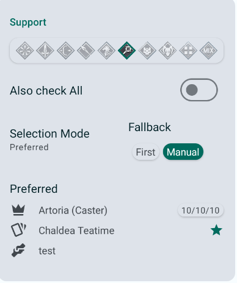
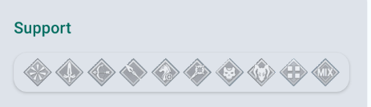
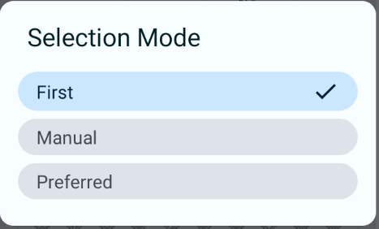
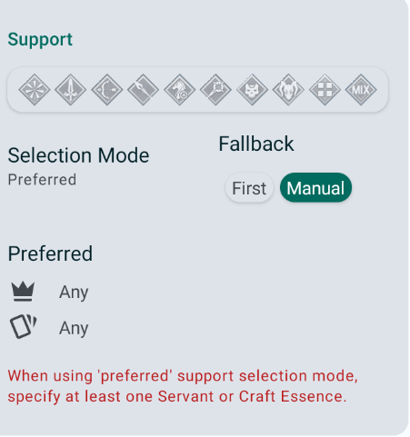
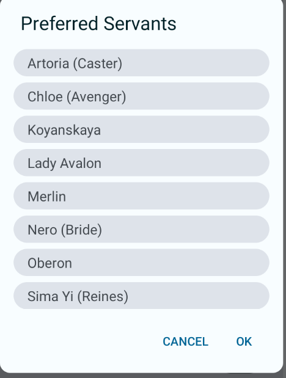
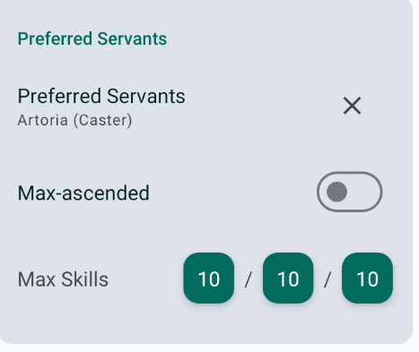
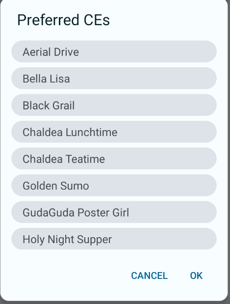
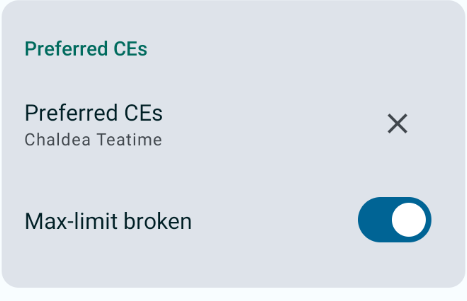
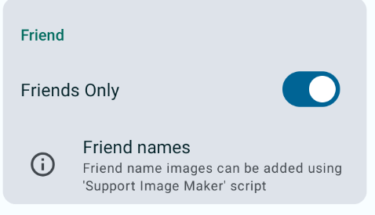
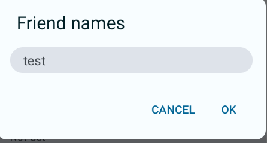

The **Support** section of a [battle config](Battle) decides which support FGA picks.

- [Class](#class)
- [Selection Mode](#selection-mode)
- [Preferred](#preferred)
  - [Servants](#servants)
  - [Craft Essences](#craft-essences)
  - [Friends](#friends)
- [Grand Servants](#grand-servants)
- [Refreshing and Fallback](#refreshing-and-fallback)

## Class

Select the class tab FGA opens on the support screen: All, one of the classes, Extra or Mix.
Tap the selected class again to deselect it. FGA then stays on whichever tab is open.

**Also check All** is available when a single class is selected. If no matching support is found in that class, FGA also searches the All tab before refreshing.

> **Warning:** This doesn't work reliably for players who haven't cleared Solomon. The "Start Quest" button stops responding until you tap the Back button in the top left.

## Selection Mode

- **First:** pick the first support in the list.
- **Manual:** stop and let you pick the support yourself. Press PLAY again afterwards.
- **Preferred** (default): pick a support that matches the [Preferred](#preferred) settings.

## Preferred

Tap **Preferred** to choose what to look for. You need at least one Servant or one CE.

FGA recognizes Servants, CEs and friends by images in your storage folder. The app comes with images of common supports. For anything else, create them with the [Support Image Maker](Support-Image-Maker).

### Servants

Select one or more Servants in **Preferred Servants**. Any of them is accepted.
You can also [import a Servant by name or Atlas ID](Support-Image-Maker.md#import-a-preferred-servant-by-name)
to use its ascension and costume portraits in this list.

Once a Servant is selected, more options appear:

- **Max-ascended:** only accept supports at their final ascension.
- **Grand Servant:** only accept Grand supports, see [Grand Servants](#grand-servants).
- **Max Skills:** only accept supports with these skills at level 10. FGA can only tell whether a skill is at level 10, not its exact level.

### Craft Essences

Select one or more CEs in **Preferred CEs**. **Max-limit broken** only accepts MLB CEs.

For event CEs, using the in-game CE filter is easier than creating CE images.

### Friends

**Friends Only** checks the row for a Friend, Guest or Follow marker. If you also
select **Friend names**, the name image must match one of your selections. This
can help you target a known support when you need a particular Servant or NP level.
For JP Agent configurations, see the [two supported Append Skill checks](Android-Automation.md#strict-support-append-skills-jp-xv).

Friend name images are created with the [Support Image Maker](Support-Image-Maker). Until you have some, the list is empty:

## Grand Servants

Grand Servants have 3 CE slots on the support screen:

1. a free slot, for any CE
2. a Bond CE slot
3. a bonus-up slot, for CEs that increase Bond, FP, QP or EXP

To pick only Grand supports, select at least one Servant and turn on **Grand Servant**. These options then appear under the CEs:

- **Match both free slot & bonus-up (Bond/FP/QP/EXP) slot:** a preferred CE must be in both slots. When off, either slot is enough.
- **Bond CE effect preference:** what the Bond CE slot must show.
  - **Ignore** (default): any Bond CE.
  - **Default effects:** the Bond CE uses its default effect.
  - **NP charge:** the Bond CE is set to NP charge.

Both options need at least one preferred CE. With none selected, Preferred mode
still skips a row that shows the blank CE marker.

The [Support Image Maker](Support-Image-Maker) also works on Grand supports. It saves the CEs in the free and bonus-up slots.

## Refreshing and Fallback

If no matching support is on screen, FGA scrolls through the list and refreshes it. How often is set in [Fine-tune](Fine-tune#support): **Swipes per Update** and **Max Updates**.

When the ordinary search returns no match, FGA uses the configured **Fallback**
mode, **First** or **Manual** (default). With a strict JP Append Skill requirement,
**Max Updates** is a hard limit. FGA stops if no verified candidate is found.
